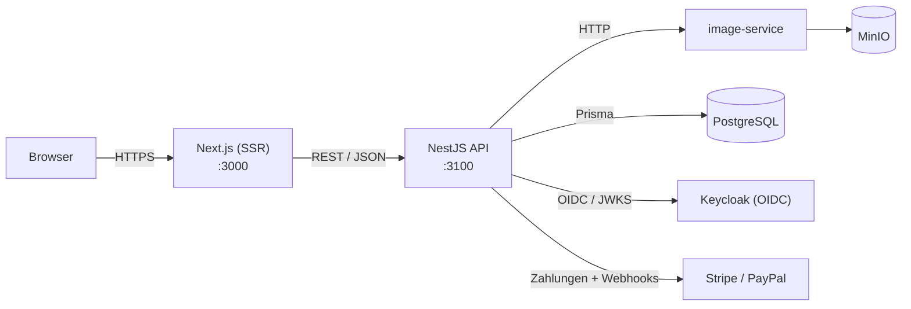
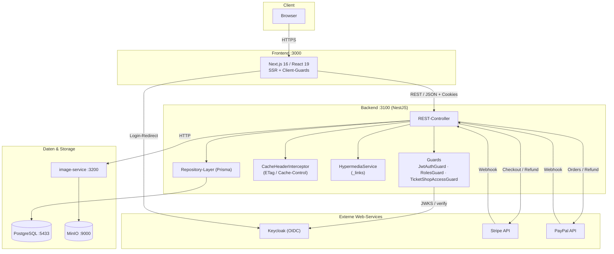
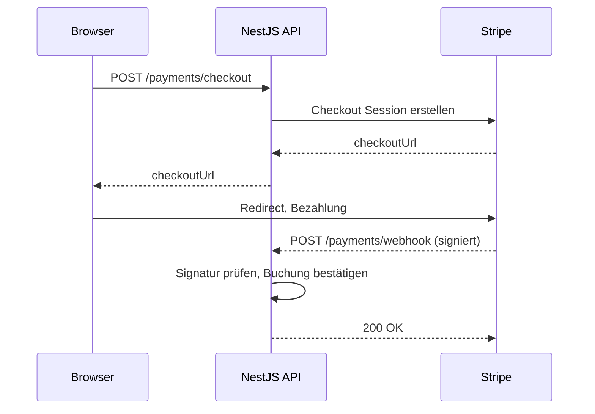
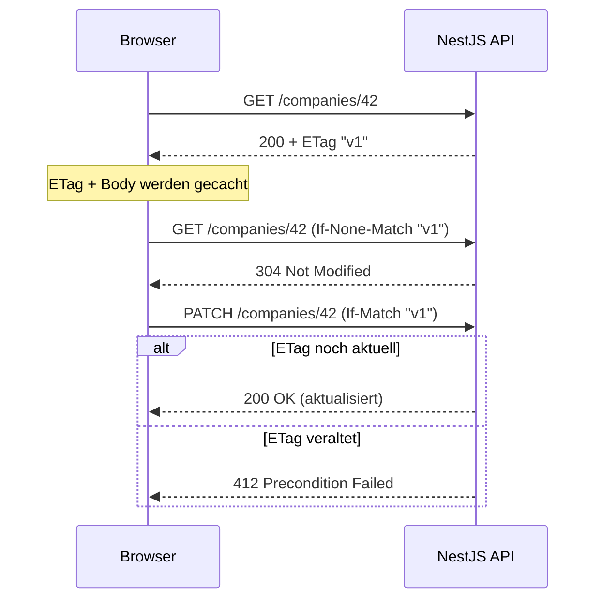
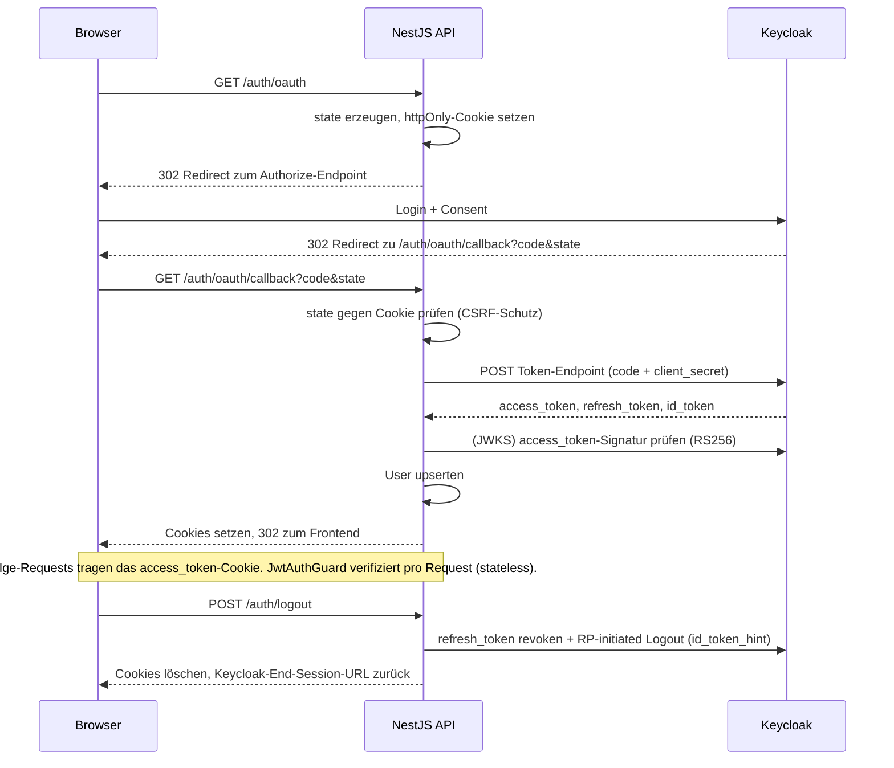

# Architektur- & REST-Review

**Projekt:** Event Planning / Plattform für Messestand-Buchungen
**Stack:** NestJS 11 (Backend) · Next.js 16 / React 19 (Frontend) · PostgreSQL + Prisma · Keycloak (OIDC) · MinIO · Docker Compose

Dieses Dokument beantwortet mit konkreten Quellverweisen:
- Wie ist das Backend REST-konform?
- Welche externen Web-Services werden genutzt (welche, wo, wie)?
- Wo und wie wird Caching eingesetzt?
- Wo und wie wird Hypermedia eingesetzt?
- Wie sieht der OAuth-Flow aus?

Jede Aussage verweist auf eine Datei und ist so direkt im Repository prüfbar.

**Verwandte Dokumente**
- `docs/rest-design-decisions.md` — begründete Design-Entscheidungen
- `docs/api-reference.md` — Endpoint-Übersicht

---

## 1. Projektüberblick

- **Companies** buchen Messestände ("Tiers") für **Events** (Messen), zahlen online und pflegen ihr Firmenprofil.
- **Admins** verwalten Events, Companies, User und sehen ein KPI-Dashboard.
- Kleine **Microservice-Landschaft**, orchestriert über `docker-compose.yml`.
- Das Backend ist **stateless**: kein Server-seitiger Session-Speicher — die Identität steckt im Keycloak-JWT.



**Zentrale Backend-Bausteine**

| Bereich | Ort |
|---|---|
| Resource-Controller | `backend/src/{companies,events,bookings,invitations,payments,auth,admin}/*.controller.ts` |
| Persistenz (Repository-Pattern über Prisma) | `backend/src/repositories/**` |
| Cross-Cutting-Concerns (REST) | `backend/src/common/**` (Interceptors, Decorators, Hypermedia, DTOs) |
| API-Dokumentation (OpenAPI / Swagger UI) | zur Laufzeit generiert, `GET /api` (`backend/src/main.ts`) |

---

## 2. Architektur (One-Pager)

- Klarer **Layered-System**-Aufbau: der Client erreicht Storage nie direkt.
- Object-Storage liegt hinter dem separaten `image-service`; die DB nur hinter dem Repository-Layer.



---

## 3. REST-Konformität

Bewertung nach dem **Richardson Maturity Model (RMM)** — dem Standard-Maßstab für REST-Reife.

| RMM-Level | Anforderung | Status | Beleg |
|---|---|---|---|
| **1 — Resources** | Eigene URIs pro Resource, Nomen statt Verben | ✅ | `/companies/:id`, `/events/infos`, `/bookings/:id`, `/admin/events/:eventId` |
| **2 — HTTP-Verben** | Korrekte Verb-Semantik | ✅ | `GET`/`POST`/`PATCH`/`DELETE`, z. B. `companies.controller.ts` |
| **2 — Status-Codes** | Sinnvolle Codes | ✅ | `201`, `204`, `304`, `400/401/403/404/409/412/422`; **`500` bewusst vermieden** |
| **3 — Hypermedia** | Links zu Folge-Aktionen | ✅ (HAL `_links`) | siehe §6 |

**Weitere REST-Eigenschaften (kurz)**
- **Stateless:** jede Anfrage wird per JWT einzeln verifiziert (`backend/src/auth/jwt.service.ts`, `backend/src/auth/guards`).
- **Uniform Interface:** durchgängig JSON; globale `ValidationPipe` (`backend/src/main.ts`); DTOs pro Resource.
- **Cacheable:** `ETag` / `Cache-Control` / Conditional Requests — siehe §5.
- **Layered System:** Storage hinter `image-service`, DB hinter Repository-Layer.
- **Self-descriptive:** vollständige OpenAPI-3-Doku unter `GET /api`.

**Ehrliche Einordnung (für faire Bewertung)**
- HATEOAS `_links` sind auf den zentralen Resources vorhanden, noch nicht flächendeckend auf *jedem* Endpoint.
- `href`s sind teils absolut, teils root-relativ — der Client normalisiert das.
- Optimistic-Concurrency-Prüfung (`If-Match` → `412`) ist aktuell auf `PATCH /companies/:id` aktiv; der Mechanismus ist wiederverwendbar und für den Rollout dokumentiert.

---

## 4. Externe Web-Services (welche · wo · wie)

| Service | Zweck | Wo im Code | Wie genutzt |
|---|---|---|---|
| **Keycloak** (OIDC IdP) | Authentifizierung, Token, Logout | `backend/src/auth/auth.controller.ts`, `backend/src/auth/jwt.service.ts` | OAuth2 **Authorization Code Flow**; Discovery via `/.well-known/openid-configuration`; **JWT-Verifikation gegen Keycloaks Remote-JWKS** (`jose`, RS256, Issuer- + `azp`-Prüfung); Token-Revocation + RP-initiated Logout (§7) |
| **Stripe** | Kartenzahlung für Buchungen/Upgrades | `backend/src/payments/payments.service.ts` | Server-SDK erstellt **Checkout Sessions**, storniert offene Sessions, erstellt Refunds; Bestätigung via **signatur-verifiziertem Webhook** `POST /payments/webhook` (`Stripe-Signature`, Raw Body) |
| **PayPal** | Alternativer Zahlungsanbieter | `backend/src/payments/payments.service.ts` (`@paypal/paypal-server-sdk`) | Erstellt/captured **Orders**, erstattet Captures; Bestätigung via `POST /payments/webhook/paypal`, Signatur **server-seitig gegen die PayPal-API verifiziert** |
| **MinIO** (S3-kompatibel) | Speicher für Firmenlogos | `image-service/src/image/image.service.ts` (`minio`-Client) | `image-service` verwaltet Bucket, `putObject`/`removeObject` und **presigned URLs**; das Backend spricht MinIO nie direkt an |
| **`image-service`** (interner Microservice) | Storage-Grenze | `backend/src/image-service/image-service.client.ts` | Backend ruft ihn per `fetch` (`/images/upload`, `/images/:key`, `/images/url/:key`) — sauberer Layered-Boundary |
| **PostgreSQL** (via Prisma) | Primärer Datenspeicher | `backend/prisma/schema.prisma`, `backend/src/repositories/**` | System of Record; nur über den Repository-Layer erreicht |
| *Prism (Stoplight)* | Dev-Mock-Backend | `docker-compose.yml` (`prism`) | Serviert die OpenAPI-Spec als Fake-API; nicht produktiv |

**Zahlungs-Ablauf (Stripe, exemplarisch)**



---

## 5. Caching

Caching ist ein wiederverwendbarer Cross-Cutting-Concern und wird vom Frontend automatisch genutzt.

**Server-Seite** — globaler Interceptor + deklarativer Decorator:
- `cache-header.interceptor.ts` läuft global. Für ein **`GET`** mit `@HttpCache(...)`:
  - setzt `Cache-Control` (Scope, `max-age`, `must-revalidate`) und `Vary`
  - berechnet einen **starken `ETag`** (quoted MD5 des JSON-Body, `etag.util.ts`)
  - liefert **`304 Not Modified`**, wenn `If-None-Match` passt
- `@HttpCache(...)` (`http-cache.decorator.ts`) deklariert die Absicht pro Route, inkl. `noStore`.

**Routen mit ETag** (GET + `@HttpCache` ohne `noStore`) — 14 insgesamt:

| Route | Scope |
|---|---|
| `GET /companies/:id` | public, 300 s |
| `GET /events/infos` · `GET /events/exhibitors` | public, 3600 s |
| `GET /auth/session` · `GET /auth/me` | private, `Vary: Authorization` |
| `GET /bookings` · `GET /bookings/:id` | laut Decorator |
| `GET /admin` · `/admin/users` · `/admin/companies` · `/admin/companies/:id` · `/admin/dashboard` · `/admin/events` · `/admin/events/:eventId` | private, `Vary: Authorization` |

- Die drei `POST /payments/*`-Routen nutzen `@HttpCache({ noStore: true })` — nie gecacht.

**Client-Seite** — `frontend/src/services/api.ts` + `etag-cache.ts`:
- speichert `{etag, body}` pro GET, sendet automatisch `If-None-Match`
- liefert bei **`304`** den gecachten Body (spart Bandbreite + Parsing)
- invalidiert den Eintrag nach jedem erfolgreichen Write

**Conditional Writes (Optimistic Concurrency)**
- Derselbe ETag dient als Concurrency-Token.
- Client sendet `If-Match` beim Write; Server vergleicht mit der aktuellen Repräsentation.
- Bei veraltetem Write → **`412 Precondition Failed`** (`assertIfMatch`, aktiv in `PATCH /companies/:id`).
- Verhindert **Lost Updates**, wenn zwei User dieselbe Company bearbeiten.



---

## 6. Hypermedia (HATEOAS)

- Responses enthalten ein **HAL-`_links`**-Objekt mit möglichen Folge-Aktionen.
- Clients navigieren über Links statt fest kodierter URLs — das Kennzeichen von RMM-Level 3.

```jsonc
// GET /companies/42
{
  "companyId": 42, "name": "Musterfirma GmbH", "...": "...",
  "_links": { "self": { "href": "/companies/42", "method": "GET" } }
}
```

**Wo erzeugt**
- Inline in Controllern/Services (`companies.controller.ts`, `bookings.service.ts`, `invitations.service.ts`, `auth.controller.ts`).
- Zentralisiert bei reicheren Links: `backend/src/common/hypermedia.service.ts` baut Event- und Booking-Links.
- **Zustandsabhängige Links:** z. B. erscheint `cancel` nur bei stornierbaren Buchungen. Der Server bietet genau die aktuell gültigen Aktionen an; die UI kann nicht angebotene Controls ausblenden.

**Wo konsumiert (Frontend)** — `frontend/src/services/link-helpers.ts`
- `getLink` / `hasLink` lösen eine Relation auf.
- `followLink` / `follow` senden die Anfrage mit der im Link deklarierten Methode.
- `MissingLinkError` trennt "Aktion nicht angeboten" von Transportfehlern.
- Beispiel: der Checkout folgt dem `payment`-Link der Buchung (`payment.service.ts`) statt die URL zu bauen.

---

## 7. OAuth 2.0 / OIDC-Flow

- **OpenID Connect Authorization Code Flow** mit Keycloak.
- Das Backend ist der OAuth-*Client*; der Browser hält nur `httpOnly`-Cookies.



**Sicherheits-Details (kurz)**
- **CSRF-Schutz:** zufälliger `state` im `httpOnly`-Cookie, im Callback geprüft.
- **Stateless-Verifikation:** `JwtAuthGuard` prüft jedes Token gegen Keycloaks **Remote-JWKS** (Issuer + `azp`, Clock-Tolerance). Public-Routen via `@Public()`.
- **Rollen-Autorisierung:** `RolesGuard` + `TicketShopAccessGuard` (z. B. Ticket-Shop nur für Admins + *verifizierte* Companies).
- **Sauberer Logout:** Refresh-Token-**Revocation** + RP-initiated Logout beenden auch die Keycloak-SSO-Session.
- Cookies: `httpOnly`, `sameSite=lax`, in Produktion `secure`.

---

## Anhang — Datei-Index

| Thema | Datei(en) |
|---|---|
| Caching-Interceptor & ETag-Util | `backend/src/common/interceptors/cache-header.interceptor.ts`, `backend/src/common/util/etag.util.ts` |
| `@HttpCache`-Decorator | `backend/src/common/decorators/http-cache.decorator.ts` |
| Hypermedia | `backend/src/common/hypermedia.service.ts`, `frontend/src/services/link-helpers.ts` |
| OAuth / OIDC | `backend/src/auth/auth.controller.ts`, `backend/src/auth/jwt.service.ts`, `backend/src/auth/guards/*` |
| Payments (Stripe/PayPal) | `backend/src/payments/payments.controller.ts`, `backend/src/payments/payments.service.ts` |
| Object-Storage | `backend/src/image-service/image-service.client.ts`, `image-service/src/image/image.service.ts` |
| API-Bootstrap (CORS, Validation, Swagger) | `backend/src/main.ts` |